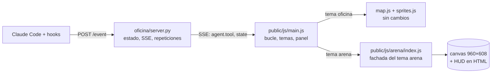
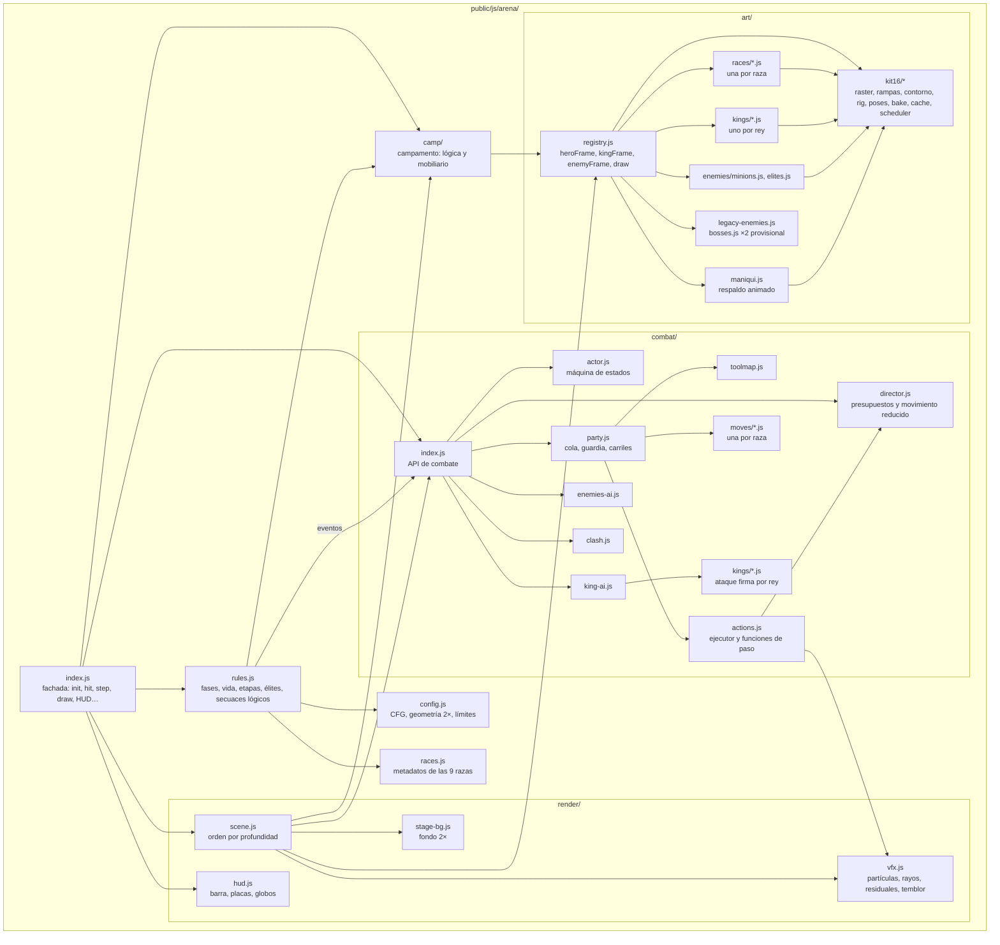
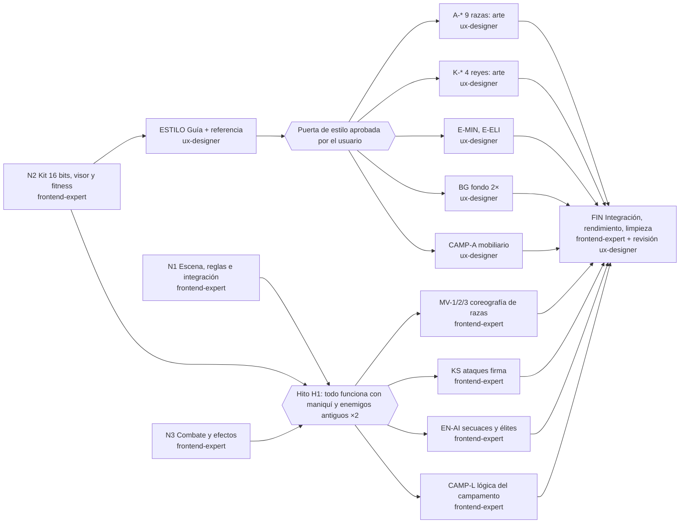

# Arena v1.2: arquitectura para sprites 16 bits y combate dinámico

- **Estado:** Propuesto
- **Fecha:** 2026-11-24
- **Base:** `docs/arena-spec.md` (v1.1 y sección «v1.2: escala 16 bits y combate dinámico»), código actual de `public/js/arena.js`, `camp.js`, `heroes.js`, `bosses.js`, `fx.js`, `main.js`, `sprites.js`, `index.html` y `oficina/server.py`.
- **Alcance decidido por el usuario:** todo de una vez (9 razas × 3 clases × etapas, 4 reyes × 3 formas, secuaces, élites, campamento), lienzo 960×608, 4 parties completas + 4 vanguardias + insignia, Tempestarios para `claude`, sin cambios de backend.

Este documento es el **contrato** entre los agentes que implementan en paralelo. Si un paquete necesita cambiar una interfaz de aquí, no la cambia por su cuenta: lo pide al dueño del núcleo y se anota una adenda al final (sección 9).

---

## 0. Resumen en una página

1. **Sprites por partes sobre un esqueleto, rasterizados a mano en un búfer indexado.** Cada raza no dibuja ~49 fotogramas por héroe: define una sola vez sus **partes** (cabeza, mechones, torso, mangas, armas…) como primitivas con material. Una **biblioteca de poses compartida** mueve el esqueleto. Un **rasterizador propio** (sin antialiasing) pinta índices `material × tono` en un `Uint8Array`, aplica el sombreado de 5 tonos con luz fija desde arriba a la izquierda, las líneas internas y el contorno `#0a0810`, y al final colorea con una paleta. La geometría no depende de la paleta, así que las variantes A/B y los colores de etapa cuestan solo un coloreado.
2. **Horneado perezoso, troceado y con caché LRU contabilizada.** La unidad de caché es una **tira** (todos los fotogramas de una animación). Hay un planificador con presupuesto por fotograma de pantalla (≤ 4 ms en combate) y un tope de 56 MB para lienzos más 8 MB para búferes de índices. Nunca se bloquea: si un fotograma no está listo, se usa el mejor disponible.
3. **Reglas separadas de la coreografía.** `rules.js` (lo que hoy es la lógica de `arena.js`) decide vida, etapas, élites y secuaces, y emite **eventos**. `combat/` convierte los eventos en **acciones** (guiones de pasos) que ejecuta una **máquina de estados por combatiente**. El daño se aplica al instante, así que la barra baja en menos de 300 ms. El golpe visual llega en cuanto lo permite la cola.
4. **Las acciones son datos construidos con funciones de paso** (`dash`, `strike`, `teleport`, `charge`, `beam`…). El movimiento reducido, el límite de acciones grandes, las imágenes residuales y el tope de destellos se aplican en **un solo sitio** (`combat/actions.js` y `combat/director.js`), no en cada raza.
5. **Un archivo por raza, por rey y por grupo de enemigos**, en dos mitades sin solape: **arte** (`art/races/<raza>.js`, para `ux-designer`) y **coreografía** (`combat/moves/<raza>.js`, para `frontend-expert`). El núcleo crea al principio los **registros y los stubs** de los 9 + 4 + 2 archivos, así ningún paquete de reparto toca un archivo compartido.
6. **Plan:** fase 1 de núcleo con 3 paquetes en paralelo, una puerta de estilo corta que se solapa con la fase 1, la fase 3 de reparto con hasta 22 paquetes independientes, y la fase 4 de integración y limpieza.

---

## 1. Contexto, atributos de calidad y supuestos

### 1.1 Atributos de calidad priorizados

| # | Atributo | Escenario medible |
|---|---|---|
| 1 | **Rendimiento** | 30 fps o más (p95 del tiempo de fotograma ≤ 33 ms) con 4 parties completas + 4 vanguardias, rey en forma 3, 10 secuaces, 2 élites y un choque de rayos. Ningún fotograma > 50 ms por horneado. Caché de sprites ≤ 64 MB. |
| 2 | **Paralelizable / modificable** | 9 razas, 4 reyes y 2 grupos de enemigos se implementan en archivos propios sin tocar archivos compartidos. Un paquete de arte se valida en el visor sin arrancar la batalla. |
| 3 | **Respuesta** | Acción visible ≤ 300 ms desde el evento si la party está libre. Barra del rey ≤ 300 ms siempre. |
| 4 | **Accesibilidad visual** | `prefers-reduced-motion` respetado en todas las acciones sin código por raza. Ningún destello a pantalla completa y ≤ 3 destellos/s por zona. |
| 5 | **Consistencia de estilo** | Las 27 clases cumplen el apartado 2.4 de la spec (contorno, 4-5 tonos, pelo con 3 masas, 2 pliegues, proporciones), comprobado automáticamente en lo medible. |
| 6 | **Compatibilidad** | Oficina sin cambios. Las repeticiones y `snapshot()` siguen funcionando. La app nunca queda a medias durante la implementación. |

### 1.2 Restricciones
- HTML/JS con módulos ES nativos, sin dependencias ni compilación. Todo el arte en código. Servidor en Python sin cambios (`server.py`, `hooks.py`).
- Se ejecuta en pywebview (WebView2/Chromium en Windows), así que hay `OffscreenCanvas`, `createImageBitmap` y Workers, pero **no se usan en la v1.2** (ver ADR-A2: el rasterizador queda preparado para moverse a un Worker si hiciera falta).
- Textos, comentarios y commits en español.

### 1.3 Datos del evento de herramienta (verificado en `oficina/server.py`)
El navegador recibe `agent.tool` en cada `PreToolUse`. `main.js` llama a `arena.hit(a, now)` en cada actualización con `state === 'working'` que no sea silenciosa. Valores reales que llegan:

| Valor de `tool` | Origen |
|---|---|
| `Read`, `Grep`, `Glob`, `LS`, `Edit`, `Write`, `MultiEdit`, `NotebookEdit`, `Bash`, `PowerShell`, `WebFetch`, `WebSearch`, `TodoWrite`, `ExitPlanMode`, `mcp__…` | `PreToolUse` normal (nombre de la herramienta) |
| `"Delegar"` | `PreToolUse` de `Task`/`Agent`, en el agente que delega |
| `"Empezando"` | `SubagentStart` y el agente destino de una delegación |
| `"Pensando"` | `UserPromptSubmit` (agente principal) |
| `null` | fin (`done`/`idle`) |

**No llega el resultado de la herramienta**, así que el «error de herramienta» (spec 4.2) **se omite**. La spec ya contemplaba esta posibilidad.

---

## 2. Arquitectura propuesta

### 2.1 Contenedores (C4 nivel 2)



### 2.2 Componentes del tema arena (C4 nivel 3)



**Reglas de dependencia** (verificadas por `tools/check_arena.py`, sección 7):
- `rules.js` no importa nada de `combat/`, `render/` ni `art/`. Solo `config.js`, `races.js` y `camp/`. Las consultas visuales que necesita, como «secuaz más cercano», se le **inyectan** (ver 4.3).
- `art/**` no importa `combat/`, `render/`, `rules.js` ni `camp/`. Un archivo de raza, rey o enemigo importa **solo** `art/kit16/*`.
- `art/kit16/{raster,ramps,outline,rig,poses}.js` no usan `document`, `window` ni el canvas (funciones puras, se podrían llevar a un Worker).
- `combat/**` usa el arte solo a través de `art/registry.js` (nunca `art/races/x.js` directamente).
- `combat/moves/*.js` y `combat/kings/*.js` importan solo `combat/actions.js` (funciones de paso) y `render/vfx.js` (pintores auxiliares). No modifican actores directamente.
- Fuera del adaptador `art/legacy-enemies.js`, ningún archivo nuevo importa `arena.js`, `heroes.js`, `bosses.js` ni `camp.js` antiguos.

### 2.3 Estructura de archivos

```
public/
  index.html                         (N1) CSS del escenado entero, sin otros cambios
  js/
    main.js                          (N1) importa ./arena/index.js; tamaño del lienzo por tema
    sound.js                         (N3) efectos nuevos: dash, rayo, choque, teletransporte, trueno
    arena.js, heroes.js, bosses.js,  (antiguos; se borran en FIN; legacy-enemies importa bosses.js)
    camp.js, fx.js
    arena/
      index.js                       (N1) fachada con la misma API que hoy tiene arena.js
      config.js                      (N1) CFG, AW=960, AH=608, puestos, carriles, puerta, límites
      races.js                       (N1) metadatos de las 9 razas: nombres, roles, umbrales, gritos, emblemas
      rules.js                       (N1) reglas de la batalla (portadas de arena.js) + cola de eventos
      camp/
        camp.js                      (N1 → CAMP-L) lógica del campamento (portada de camp.js)
        acts.js                      (N1 → CAMP-L) tabla de actividades, pesos y frases
        props.js                     (N1 → CAMP-A) mobiliario y objetos a 2×
      combat/
        index.js                     (N3) API: onEvents, update, drawables, views, pause
        actor.js                     (N3) máquina de estados y muelle de retroceso
        actions.js                   (N3) ejecutor de guiones y funciones de paso
        party.js                     (N3) cola por party, ráfaga, guardia, carriles, formación
        toolmap.js                   (N3) herramienta → tipo de acción
        director.js                  (N3) acciones grandes, choques, residuales, efectos reducidos, destellos, movimiento reducido
        king-ai.js                   (N3) coreografía genérica del rey
        enemies-ai.js                (N3 → EN-AI) secuaces y élites
        clash.js                     (N3) choque de rayos
        moves/
          index.js                   (N3) registro de las 9 (no se toca después)
          generic.js                 (N3) movimientos por defecto de cada clase
          tempestarios.js … astrales.js   (N3 crea stubs → MV-1/2/3)
        kings/
          index.js                   (N3) registro
          kazgorath.js vhel.js ysgrim.js tzar.js   (N3 crea stubs → KS)
      render/
        scene.js                     (N1) composición, orden por profundidad, selección, sombras
        hud.js                       (N1) barra del rey, placas, banners, globos, resumen
        vfx.js                       (N3) partículas, proyectiles, rayos, impactos, residuales, temblor, destellos
        stage-bg.js                  (N1 provisional → BG) fondo de la arena a 2×
      art/
        registry.js                  (N2) heroFrame / kingFrame / enemyFrame / drawFrame + prehorneado
        maniqui.js                   (N2) raza maniquí: respaldo animado y referencia del rig
        legacy-enemies.js            (N1) reyes, élites y secuaces de bosses.js ampliados ×2 (provisional)
        kit16/
          raster.js                  (N2) búfer indexado y primitivas (sin DOM)
          ramps.js                   (N2) rampas de 5 tonos, materiales, paletas Uint32
          outline.js                 (N2) contorno exterior y líneas internas (sin DOM)
          rig.js                     (N2) esqueleto, tipos de cuerpo, cinemática directa
          poses.js                   (N2) biblioteca de poses (héroes, rey, élites, secuaces)
          bake.js                    (N2) partes + pose → índices → color → tira (canvas)
          cache.js                   (N2) LRU con contabilidad de bytes
          scheduler.js               (N2) cola de horneado troceada con presupuesto
        races/
          index.js                   (N2) registro de las 9 (no se toca después)
          tempestarios.js humanos.js elfos.js enanos.js orcos.js gnomos.js bestiales.js draconios.js astrales.js
        kings/
          index.js                   (N2) registro
          kazgorath.js vhel.js ysgrim.js tzar.js
        enemies/
          minions.js                 (N2 stub → E-MIN)
          elites.js                  (N2 stub → E-ELI)
  dev/
    arte16.html, arte16.js           (N2) visor de sprites y comprobaciones automáticas de estilo
tools/
  check_arena.py                     (N2) reglas de arquitectura (biblioteca estándar)
docs/
  arena-estilo-16bits.md             (ESTILO) guía de estilo de ux-designer
```

«(X → Y)» quiere decir que el paquete X crea el archivo y se lo **entrega** a Y, que pasa a ser su único dueño. La entrega queda en el commit de X, que debe dejar el archivo funcionando.

---

## 3. Sistema de sprites 16 bits

### 3.1 Formato elegido: partes sobre esqueleto, rasterizadas en un búfer indexado (ADR-A1)

```
definición de raza ──► rig (pose de la biblioteca) ──► partes (primitivas + material) ──► raster indexado (Uint8, material×tono)
     ──► sombreado por volumen (5 tonos) ──► líneas internas (sel-out) ──► contorno exterior ──► paleta Uint32 (variante, etapa)
     ──► ImageData ──► tira de fotogramas (canvas) ──► caché LRU
```

**Por qué no mapas de píxeles en strings:** con 27 clases × 49 fotogramas × etapas son unos 4.000 fotogramas de unos 50×65 caracteres, imposibles de mantener y de dibujar con coherencia entre varios agentes. **Por qué no primitivas de canvas con umbral de alfa** (lo que hace hoy `bosses.js`): `getImageData` en cada horneado es lento, el antialiasing del canvas obliga a endurecer bordes y no da control del tono por píxel. El rasterizador propio es determinista, rápido, sin DOM y da el sombreado por rampas «gratis».

### 3.2 Búfer indexado y materiales
- Búfer `Uint8Array` de `w × h` por fotograma. Valor `0` = transparente. Para el material `m` (0..49) y el tono `t` (0..4): `1 + m*5 + t`. `253` = blanco puro (brillo de ojos), `254` = emisivo (sin sombra, color `emit` de la paleta), `255` = contorno.
- Búfer paralelo de **grupo** (`Uint8Array`, id de parte por profundidad) para las líneas internas.
- Cada raza declara sus materiales (`skin`, `hair`, `cloth`, `cloth2`, `trim`, `leather`, `metal`, `iris`…) como **nombres**. `ramps.js` los convierte en índices.

### 3.3 Rampas de 5 tonos
- Orden fijo: `[0] sombra profunda, [1] sombra, [2] base, [3] luz, [4] brillo`.
- `ramp5(base)` genera una rampa con desplazamiento de tono (las sombras van hacia azul-violeta y bajan de saturación, las luces hacia amarillo cálido), típico de los 16 bits. `ramp5([h0..h4])` acepta tonos explícitos (los Tempestarios los traen en la spec 3.2). Una rampa de 3 o 4 tonos se expande repitiendo los extremos (tope 5).
- Paleta final: `Uint32Array(256)` construida por `(raza, variante, etapa)` con `palette(raceArt, variant, stage)`. El coloreado de un fotograma es un bucle `out32[i] = pal[idx[i]]`.
- Contorno: `#0a0810` (constante `CONTOUR` en `ramps.js`, la misma para todos).

### 3.4 Sombreado (en el rasterizador, no a mano)
Cada primitiva indica cómo se sombrea (`shade`):
- `'vol'` (por defecto, para bultos): tono por la posición normalizada dentro de la forma respecto a la luz `L = (-0.6, -0.8)`, en bandas `>0.75 → 4`, `>0.3 → 3`, `>-0.3 → 2`, `>-0.7 → 1`, `resto → 0`. Después, una **pasada de borde**: si el píxel en `(+1,+1)` está fuera de la forma, baja un tono; si lo está el de `(-1,-1)`, sube a luz.
- `'cyl'` (extremidades, mechones, faldones): tono por la distancia perpendicular al eje del segmento, con el lado de la luz más claro.
- `'sphere'` (cabeza, orbes, hombreras): `'vol'` con brillo puntual de 1-2 px.
- `'flat'`: un solo tono (indicado con `tone`).
- Las partes de la capa `far` (brazo y pierna del lado lejano) bajan **un tono** automáticamente.
- Sin degradados ni tramado, como pide la spec 2.4. Opcionalmente, tramado 2×2 solo en la transición entre tonos 1 y 2 de superficies grandes del rey (`dither:true`).

### 3.5 Contorno y líneas internas
- **Contorno exterior:** todo píxel transparente con un vecino opaco en 4-vecindad pasa a ser `255`. Opción `outline8:true` por raza o rey para la 8-vecindad (más grueso, útil en el rey). El búfer lleva 1 px de margen.
- **Líneas internas (sel-out):** en el borde entre dos grupos con `line:true`, el píxel de la parte **delantera** toma el tono 0 de **su propio** material. Así los volúmenes se separan sin dibujar negro dentro del personaje. Por defecto, `line:true` en brazo cercano sobre torso, pelo sobre cara, arma sobre cuerpo y capa sobre piernas.
- Los materiales emisivos (rayos, runas, ojos brillantes) no reciben línea interna ni sombra.

### 3.6 Esqueleto (rig) y tipos de cuerpo
- Articulaciones (vista lateral mirando a la derecha; `N` = lado cercano, `F` = lado lejano): `root` (pelvis), `spine`, `chest`, `neck`, `head`, `shN elN haN`, `shF elF haF`, `hipN knN ftN`, `hipF knF ftF` y, opcionales, `tail1..3` y `wing`.
- **Tipos de cuerpo** en `rig.js` (proporciones base, la cabeza ≈ 1/4,5 de la altura): `atleta` (humanos, elfos, tempestarios, astrales), `robusto` (enanos, orcos), `menudo` (gnomos), `fiera` (bestiales: encorvado, piernas digitígradas opcionales), `draco` (draconios: cola) y `etereo` (astrales flotantes: pies a `z` > 0 en reposo). Cada clase fija `build: { body, height, shoulder, hip, leg, arm, headScale }` y el rig escala las longitudes.
- **Pose** = `{ root:[dx,dy], lean, a:{ articulación: ángulo° }, z, squash }`. La cinemática directa calcula la posición de cada articulación.
- **Mirar a izquierda o derecha:** se dibuja siempre mirando a la derecha y la izquierda se obtiene reflejando al dibujar (`scale(-1,1)`, sin coste de memoria). No hay vistas de frente ni de espalda en la arena: el campamento también pasa a vista lateral.

### 3.7 Biblioteca de animaciones (contrato de nombres y fotogramas)

**Héroes (49 fotogramas)**, que salen de `poses.js` por tipo de cuerpo:

| Animación | Fot. | Uso | Animación | Fot. | Uso |
|---|---|---|---|---|---|
| `idle` | 4 | guardia, reposo de pie | `cast` | 4 | apoyo y hechizo |
| `walk` | 6 | caminar | `hit` | 2 | golpeado |
| `run` | 4 | correr y embestida | `block` | 1 | bloqueo |
| `atk1` `atk2` `atk3` | 3+3+3 | combo de 3 golpes | `launched` | 2 | lanzado por los aires |
| `charge` | 3 | carga | `victory` | 3 | celebración |
| `fire` | 2 | disparo o lanzamiento | `transform` | 3 | transformación |
| `sit` | 2 | sentado | `sleep` | 2 | dormir |
| `eat` | 2 | comer o beber | | | |

- Una raza puede **añadir** animaciones propias en `extraAnims` (por ejemplo `kick: 3` para los Tempestarios) con sus poses. Si un movimiento pide una animación que la raza no tiene, el registro usa la de reserva: `kick → atk3`, cualquier `atk* → atk1`, y por último `idle`.
- El **pelo y la ropa con vaivén** no necesitan fotogramas extra: la definición recibe `ctx.phase` (0..1 dentro del ciclo) y desplaza las puntas de mechones y faldones.

**Rey (21 por forma):** `idle 4, hit 2, lean 1 (esquiva), claw 3, lunge 2 (embestida), roar 2, charge 2, beam 2, cast 3 (ataque firma)`. Los reyes no usan el rig humano: su pose es un **conjunto de parámetros** (`{ lean, armN, armF, mouth, wing, breathe, tail }`) que su función de dibujo interpreta, igual que hoy `kazgorath(D, f)`. `poses.js` da los valores por animación y fotograma, y el rey puede sobrescribirlos.

**Élites (12):** `idle 2, move 4, atk 3, hit 1, special 2`. **Secuaces (7):** `idle 2, move 2, atk 2, launched 1`.

Los élites y secuaces se **hornean una vez en índices** y se colorean con la paleta de cada rey (hoy se tiñen con `king.pal`). La geometría es compartida por los 4 reyes.

### 3.8 Contrato de un archivo de raza (`art/races/<id>.js`)

```js
// Solo importa de '../kit16/*'. Sin Math.random (usar ctx.rng si hace falta).
import { ramp5 } from '../kit16/ramps.js';
export default {
  id: 'tempestarios',
  kit: 1,                                   // versión del contrato del kit (KIT_VERSION)
  ready: true,                              // false = el registro usa el maniquí tintado
  materials: ['skin', 'cloth', 'trim', 'leather', 'hair', 'spark', 'iris', 'metal'],
  // Rampas por variante (0 = A, 1 = B) y etapa (1..4). Devuelve { material: [5 hex] }
  ramps(variant, stage) { /* ... */ },
  emit(variant, stage) { return '#e0d0ff'; },   // color del material emisivo
  geomStage: s => s,                        // etapas que comparten geometría (p. ej. s => s < 3 ? 1 : s)
  extraAnims: { kick: 3 },
  extraPoses: { atleta: { kick: [/* 3 poses */] } },
  classes: [                                // índice 0 vanguardia, 1 distancia o magia, 2 apoyo
    { id: 'relampago', name: 'Relámpago',
      build: { body: 'atleta', height: 60 },
      draw(P, ctx) { /* partes; ver API del pintor */ },
      anchors: ['haN', 'haF', 'head', 'chest'] },   // puntos que se exportan en el descriptor
    /* ... */
  ],
  stageScale: [1, 1, 1, 1.1],               // escala del rig por etapa (Ojo de la Tormenta ×1,1)
  // Efectos vivos por etapa (aura, órbitas, marcas que laten): se pintan cada fotograma en pantalla
  fx: { back(g, c, stage) {}, front(g, c, stage) {} },
  transformFx(g, c, k, from, to) {},        // remate visual de la transformación (p. ej. rayo que cae); k: 0..1
};
```

**API del pintor `P`** (en `bake.js`, sobre `raster.js`). Las coordenadas son del mundo del fotograma y los puntos se pueden dar relativos a una articulación con `P.j('haN', dx, dy)`:

| Método | Qué hace |
|---|---|
| `P.layer('far' \| 'body' \| 'near' \| 'top')` | cambia la capa (orden y grupo para las líneas internas) |
| `P.j(nombre, dx=0, dy=0)` / `P.ang(segmento)` | posición de una articulación y ángulo de un segmento |
| `P.limb(seg, mat, w0, w1, o)` | cápsula entre las dos articulaciones de un segmento (`'armN.upper'`, `'legF.lower'`…), sombreado `'cyl'` |
| `P.blob(pt, rx, ry, mat, o)` | elipse (`o.rot`, `o.shade`) |
| `P.poly(pts, mat, o)` / `P.smooth(pts, mat, o)` | polígono y polígono suavizado (cuadráticas rasterizadas) |
| `P.strip(pts, w0, w1, mat, o)` | tira que se afina (capas, colas, cuernos, mechones) |
| `P.lock(raíz, { ang, len, w, curve, sway }, mat)` | mechón de pelo con vaivén según `ctx.phase` |
| `P.fold(pts, mat)` | pliegue: línea de tono 1 con luz de tono 3 al lado |
| `P.line(pts, mat, tone)` | línea de 1 px (Bresenham) |
| `P.eye(pt, { iris, size: 2\|3, lid })` | ojo de 2-3 px con brillo `253` |
| `P.emit(forma)` | píxeles emisivos (marcas, rayos dibujados en el cuerpo) |
| `P.anchor(nombre, pt)` | exporta un punto para los efectos (`muzzle`, punta del arma) |

`ctx`: `{ stage, anim, frame, phase, cls, build, face: 1, rng }`.

### 3.9 Descriptor de fotograma (lo que reciben `combat/`, `render/` y `camp/`)

```js
// heroFrame(raceId, cls, stage, variant, anim, frame) → Frame
{ img,            // canvas de la tira (o del maniquí/legacy si aún no está listo)
  sx, sy, w, h,   // rectángulo dentro de la tira
  ax, ay,         // punto de apoyo: centro de los pies (relativo al rectángulo)
  pts: { haN, haF, head, chest, muzzle, ... },   // relativos a los pies, mirando a la derecha
  top,            // altura visible (para placas y globos)
  ready }         // false si es un sustituto
```

`drawFrame(g, f, x, y, { face=1, z=0, alpha=1, flash=0, tint=null })` es la **única** función que pinta sprites. Aplica el reflejo, la altura `z` (la sombra la pinta `scene.js` en el suelo) y el destello. El destello blanco se genera con un lienzo auxiliar compartido (`source-in`), sin cachear siluetas blancas por fotograma, y lo autoriza el limitador de destellos del director.

Equivalentes: `kingFrame(kingId, form, anim, frame)` y `enemyFrame(kind: 'minion'|'elite', type, kingId, anim, frame)`.

### 3.10 Caché y presupuesto de memoria (ADR-A2)

**Unidad de caché:** la tira `geomKey|variant|stage`, con `geomKey = raza|clase|geomStage|anim` para héroes. Una tira por animación reduce el número de lienzos unas 5 veces frente a uno por fotograma.

Dos niveles en `cache.js`:
1. **Índices** (`Uint8Array`, 1 B/px): LRU de **8 MB**. Permiten volver a colorear sin rasterizar (variante B, cambio de etapa con la misma geometría).
2. **Lienzos RGBA** (4 B/px contabilizados): LRU de **56 MB**. No se expulsa nada usado en los últimos 2 s.

Estimación del pico (fotograma medio de héroe ≈ 56×72 px ≈ 16 KB y hasta 30 KB en golpes con arma extendida, unos 20 KB de media):

| Concepto | Cálculo | MB |
|---|---|---|
| Héroes en batalla | 16 visibles × 49 fot. × 20 KB | ~16 |
| Transformación (etapa anterior, solo `idle` y `transform`) | 16 × 7 × 20 KB | ~2 |
| Campamento (7 parties, etapa 1) | 21 héroes × ~26 fot. (`idle`, `walk`, `sit`, `sleep`, `eat` y las de actividades) × 20 KB | ~11 |
| Rey: forma actual + siguiente | 2 × 21 fot. × ~300 KB (≈ 260×300 px) | ~13 |
| Élites (2) y secuaces (4 tipos) | 2×12×58 KB + 4×7×6 KB | ~1,6 |
| Fondo y mobiliario | 960×608×4 + objetos | ~3 |
| **Total estimado** | | **~47 MB** (< 56 + 8) |

- Las tiras del rey de una batalla anterior se descartan en `kingDie` + `CALM_MS` (es el mayor consumidor).
- El modo `?debug=arena` muestra los MB de cada nivel, el número de tiras, la cola de horneado, el horneado más largo y el p95 del fotograma.

### 3.11 Horneado sin parones (≤ 50 ms) (ADR-A2)
- **Objetivo de coste:** ≤ 2 ms por fotograma de héroe y ≤ 12 ms por fotograma de rey en el equipo del usuario. El criterio de terminado de cada paquete de arte lo comprueba en el visor.
- **Horneado troceado:** `bake.js` es un generador (`function*`) que cede el control después de cada parte (y de cada franja de 32 filas en el sombreado y el contorno del rey). `scheduler.js` lo avanza con un presupuesto por fotograma de pantalla: **4 ms** si hay combate y **8 ms** si no. La cola tiene prioridades: `0` lo pedido para dibujar ahora, `1` prehorneado inmediato, `2` especulativo.
- **Nunca se bloquea:** si `heroFrame` pide algo que no está, encola con prioridad 0 y devuelve el **mejor disponible**: fotograma anterior de la misma tira, después `idle` 0 de ese héroe y por último el maniquí tintado (siempre horneado al inicio, son 49 fotogramas por tipo de cuerpo). Como máximo **un** horneado síncrono por fotograma de pantalla, y solo para el `idle` 0 de un héroe sin nada disponible (≤ 3 ms).
- **Prehorneado** (`registry.prewarm(...)`):
  - Al abrir el tema arena, `idle` y `walk` de las razas de los agentes conocidos (lista del panel).
  - En `partyJoin`, `walk` y `run` primero (la party sale caminando, más de 0,7 s de margen), después `idle`, `atk1..3`, `charge`, `fire`, `cast`, `hit` y `block`, y por último el resto.
  - En `partyStage` próximo (poder ≥ 80 % del umbral), las tiras de la etapa siguiente.
  - En `kingSpawn`, el `idle` del rey durante los 2 s de aparición; después el resto de la forma y la forma siguiente con prioridad 2.
- **Pestaña oculta:** el planificador se para con `document.hidden` y retoma al volver.

---

## 4. Sistema de animación y acciones

### 4.1 Reparto de responsabilidades (ADR-A3)

| Quién | Es dueño de | No hace |
|---|---|---|
| `rules.js` | fases, vida, poder, etapas, élites y secuaces **lógicos** (vivo o muerto, vida), parties lógicas (estado, puesto, temporizador del recorrido por la puerta), campamento lógico vía `camp/` | dibujar, posiciones de coreografía |
| `combat/` | actores visuales (posición = **ancla** de reglas + **desplazamiento** de coreografía), máquinas de estados, colas, IA visual de rey y enemigos, efectos | cambiar vida, etapas o daño |
| `camp/` | grupos en reposo, actividades y sus posiciones | combate |
| `render/` | componer, ordenar, HUD | lógica |

Hoy `arena.js` calcula recorridos (`setPath`, `heroPos`) y mueve secuaces (`updateEnemies`). En la v1.2, **`rules.js` conserva solo el temporizador y los extremos** del recorrido (para que la llegada y la salida sigan siendo deterministas, como hoy) y `combat/` anima a los héroes por ese recorrido. Los secuaces y élites pasan a moverse en `combat/enemies-ai.js`.

### 4.2 Eventos de reglas a combate (contrato)
`rules.js` acumula eventos en una cola que `combat.onEvents(list)` vacía en cada `step`. Es más simple y determinista que un bus con suscriptores.

| Evento | Campos |
|---|---|
| `partyJoin` | `name, race, variant, from: 'camp'\|'gate', heroes?: [{x,y}×3]` |
| `partyEnter` | `name, slot, path: [{x,y}…], t0, dur` (sale hacia su puesto) |
| `partyArrive` | `name, slot` |
| `partyExit` | `name, path, t0, dur` |
| `partyToCamp` | `name` (`combat` suelta sus actores; `camp/` toma las posiciones) |
| `partyStage` | `name, from, to` |
| `tool` | `name, tool, pts, target: { kind: 'elite'\|'minion'\|'king', id }, burstIndex` |
| `passive` | `name, pts` |
| `teamCombo` | `name` (golpe combinado de etapa 3 cada 30 s, regla 1.1) |
| `finisher` | `names: […]` (golpe final conjunto) |
| `celebrate` | `name` |
| `minionSpawn` / `minionKill` | `id, type` / `id, by: name` |
| `eliteSpawn` / `eliteHit` / `eliteDown` | `id, type, side` / `id, pts` / `id` |
| `kingSpawn` / `kingHit` / `kingForm` / `kingDie` | `id, form, appear` / `pts` / `form` / `reason` |

**Consultas inyectadas** (`rules.init({ nearestMinion, heroPositions })`, las implementa `combat`): `nearestMinion(partyName) → id | null` (la regla 1.1 de «el más cercano a la party» necesita posiciones visuales) y `heroPositions(name) → [{x,y}×3]` (lo que hoy hace `heroPos` en `toCamp`). Si no hay combate cargado, por defecto se usa el secuaz más antiguo y el puesto.

**Cambios de reglas de la v1.2** (todos en `rules.js`, `config.js` y `races.js`):
- Etapas por raza: `race.stages = [{ n, power, mult }…]`. Las 8 razas siguen con `[0,10,25]` y `[1,1.5,2]`. Los Tempestarios llevan `[0,8,20,40]` y `[1,1.5,2,2.5]`.
- Refuerzo tardío: `LATE_POWER = 5`. Si el rey está en forma 3 y la raza tiene 4 etapas, el poder inicial es el umbral de su etapa 2 (spec 3.3).
- `FULL_PARTIES = 4`, `VISIBLE_PARTIES = 8`, insignia «+N parties» a partir de la 9.ª.
- Asignación: `claude → tempestarios`. `product-owner` sigue con humanos. `hash mod 8` se calcula **solo sobre las 8 razas originales, en su orden actual** (los Tempestarios no se asignan por hash).
- Todas las coordenadas ×2 en `config.js`.
- `snapshot()` conserva su forma actual (sirve para depurar y para comparar con la versión antigua) y añade `stages` por party.

### 4.3 Geometría a 2× (`config.js`), propuesta inicial que N1 ajusta con ux-designer

| Elemento | Valor |
|---|---|
| Lienzo | `AW = 960`, `AH = 608` |
| Rey | pies en `KING_Y = 340`, `CX = 480`. Desplazamiento máximo ±80 px |
| Empalizada / puerta | `FENCE_Y = 496`, `GATE_X = 480`, `GATE_IN = (480, 516)`, `GATE_OUT = (480, 482)` |
| Puestos de party completa (pies de la vanguardia) | `(480,472) (250,462) (710,462) (90,444)` |
| Puestos de solo vanguardia | `(370,410) (590,410) (160,404) (800,404)` |
| Formación | vanguardia `(0,0)`, distancia `(-36,-16)`, apoyo `(36,-16)` (los dos de atrás miran al mismo objetivo) |
| Carriles | ±120 px con 1-2 parties completas, ±80 con 3-4, ±60 las de solo vanguardia |
| Límite superior de pies de héroe | `y ≥ 352` (siempre por debajo del rey, spec 4.6) |
| Campamento | franja `y ≥ 496`, 7 puestos `CAMP_SLOTS` ×2 de los actuales |

Criterio para N1: con 4 completas + 4 vanguardias en guardia no se solapan pies ni placas, y el rey no tapa a ninguna party (HU-15, escenario «encaje»).

### 4.4 Máquina de estados por combatiente (`combat/actor.js`)

Un **actor** representa a un héroe, al rey, a un élite o a un secuaz:

```js
{ id, kind, ref,            // ref: { race, cls, variant } | { kingId } | { type }
  home: {x,y},              // ancla (de reglas o del puesto)
  x, y, z, face,            // posición actual; z = altura sobre el suelo (saltos, lanzado)
  state, t0, dur,           // estado actual
  anim, frame,              // lo que se dibuja (lo resuelve el estado o el paso del guion)
  script, step, stepT0,     // guion en ejecución (acción)
  recoil: { dx, v },        // muelle de retroceso aditivo (golpe recibido)
  ghosts: [],               // imágenes residuales (máx. 4; 0 en efectos reducidos)
  flashAt, alpha, lane:{x0,x1}, priority }
```

**Estados:** `guard` (reposo en combate: vaivén, pasitos de recolocación, mira al objetivo), `move` (caminar o correr por un recorrido), `dash`, `attack` (paso de combo con preparación, golpe y recuperación; el **impacto** se dispara en el fotograma activo), `charge`, `beam`, `shoot`, `cast`, `hit`, `launched` (arco en `z` con aterrizaje), `block`, `dodge`, `teleport` (desaparece → invisible → aparece), `transform`, `celebrate`, `enter`, `exit`.

`rest:*` **no** es de este actor: lo pinta `camp/` con `heroFrame` directamente.

**Prioridades y quién interrumpe a quién:**

| Prioridad | Estados | Regla |
|---|---|---|
| 10 | `transform` | lo interrumpe todo; la cola de la party espera a que termine |
| 5 | guion de acción (`dash`, `attack`, `charge`, `beam`, `shoot`, `cast`, `teleport`) | no lo interrumpe ninguna reacción |
| 3 | reacción (`hit`, `block`, `dodge`, `launched`) | solo entra si el actor está en `guard` o `move` |
| 1 | `guard`, `move`, `enter`, `exit`, `celebrate` | base |

- **Recibir golpe** en el rey y en los élites **no es un estado** sino un **impulso del muelle** `recoil` más un destello. Se suma a lo que esté haciendo, así un golpe no rompe su coreografía. Retrocede 4-16 px y vuelve en menos de 0,6 s (HU-18). Si el héroe que golpea está a la derecha, el impulso va hacia la izquierda.
- Los héroes **nunca** pierden: los ataques enemigos producen `block` (vanguardia, 50 %), `dodge` (resto, 30 %) o `hit` (20 %) solo si el héroe está en `guard`. Retroceso de 6-10 px. `launched` solo lo provocan ataques grandes del rey (máx. 1 héroe por ataque).
- **Carril:** al final de cada paso se limita la `x` al carril y la `y` a `≥ 352`. Los pasos marcados `leavesLane` (teletransporte, técnica de equipo, embestida al rey) pueden salir del carril, pero el guion **debe** terminar con `home()`. `actions.js` lo comprueba al compilar.

### 4.5 Acciones como datos (`combat/actions.js`) (ADR-A4)

Una **acción** es un guion: una lista de pasos creados con funciones de `actions.js`. Los archivos `moves/*.js` solo combinan esas funciones, nunca tocan `actor.x` directamente.

```js
import { run, dash, strike, teleport, jumpBack, charge, beam, shoot, cast, buff, home, wait, fx, combo } from '../actions.js';
// Movimientos de una raza (moves/<id>.js). Cualquier clave que falte se toma de generic.js
export default {
  vanguard: {
    probe:  s => [dash('target.front', 140), strike('atk1', 180, { knock: 6 }), home(220)],
    combo:  s => [dash('target.front', 160, { ghosts: s.stage >= 2 ? 3 : 0 }),
                  ...combo(['atk1', 'atk2', 'atk3'], 110, { knock: 4 }),
                  strike('kick', 160, { knock: 16, launch: true, fx: 'spark' }), home(260)],
  },
  ranged:  { beam: s => [charge(500, { ring: 'arcs' }), beam(400, { style: 'violet', big: true }), wait(100)],
             longshot: s => [jumpBack(-40, 160), shoot('orb', 320)] },
  support: { buff: s => [cast(400, { halo: true }), buff(['vanguard', 'ranged'], 1000)] },
  team: s => [/* técnica de equipo: 3 guiones sincronizados, uno por héroe */],
  styles: { vanguard: { spark: '#d8c4ff' }, ranged: { projectile: 'orb', beamRamp: [/* 5 */] }, support: { light: '#e0d0ff' } },
  paint: { /* pintores propios de proyectiles o técnica de equipo, con helpers de vfx.js */ },
};
```

- Destinos de los pasos (`'target.front'`, `'target.behind'`, `'target.above'`, `'home'`, `{dx,dy}`): se resuelven al ejecutar con el **descriptor del objetivo**. El rey expone `strikePoints` delante, a cada lado y arriba, ya limitados a `y ≥ 352`. Los élites y secuaces exponen el suyo.
- **Impacto:** en el fotograma activo de `strike`, `shoot` o `beam`, se emite `impact { target, knock, launch, fx }`. Esto provoca el impulso del muelle del objetivo, el destello (si lo permite el limitador), la cifra de daño (se mueve de «al recibir el evento» a «al impactar») y, si el objetivo es un secuaz condenado, su vuelo en arco.
- **Regla de latencia:** el primer impacto de cualquier acción ocurre a ≤ 250 ms del inicio. `actions.js` avisa en consola, en modo `?debug=arena`, si un guion la incumple.
- **Secuaz condenado:** `minionKill` lo marca y el primer impacto de la party lo lanza en arco. Si en 800 ms no hubo impacto (party sin puesto visible, por ejemplo), sale despedido igualmente.

### 4.6 Cola por party (`combat/party.js`) y latencia (ADR-A7)
- **1 acción a la vez** por party. Las que llegan mientras tanto se encolan (**máx. 3**). Las siguientes se **funden** en la última encolada, que pasa a ser `burst` (combo rápido de 0,5 s que cuenta todas). El daño ya lo aplicaron las reglas, así que la cola solo afecta a lo visual.
- **Compresión:** mientras haya cola, la acción en curso corre a ×1,6 y las encoladas se ejecutan en «modo rápido» (sin preparación). Así, con la party ocupada, la siguiente acción empieza en ≤ 600 ms. Con la party libre empieza en el fotograma siguiente (≤ 300 ms, HU-17).
- **Transformación:** la cola espera y no se pierden acciones (HU-17, caso borde).
- **Pestaña oculta** (`visibilitychange`): `combat.pause()` vacía las colas y deja a todos en `guard`. Al volver no se reproduce nada acumulado (HU-23).
- **Guardia viva:** si la party trabaja y lleva 4-6 s sin acción, hace un **cruce de golpes** sin daño con el secuaz más cercano o con el rey (acción `spar` de `generic.js`). El daño pasivo (`passive`) también lo dispara.
- **Quién actúa:** según `toolmap.js` (4.7). En las parties de solo vanguardia, todas las acciones las hace la vanguardia: `beam` y `longshot` pasan a `combo` con remate, `buff` a `probe` y `team` a `combo`.

### 4.7 Herramienta a acción (`combat/toolmap.js`)

| `tool` | Acción | Actor |
|---|---|---|
| `Read`, `Grep`, `Glob`, `LS` | `probe` (tanteo, 0,4 s) | vanguardia |
| `Edit`, `Write`, `MultiEdit`, `NotebookEdit` | `combo` (0,9 s; se alarga por etapa, spec 4.2) | vanguardia |
| `Bash`, `PowerShell` | `beam` (rayo cargado, 0,9 s) | distancia |
| `WebFetch`, `WebSearch`, `mcp__*`, navegador | `longshot` (0,8 s) | distancia |
| `TodoWrite`, `ExitPlanMode`, `"Pensando"` | `buff` (0,8 s) | apoyo |
| `"Delegar"` | `team` si la etapa es ≥ 3 y pasaron ≥ 8 s desde la última; si no, `combo` | los 3 |
| `"Empezando"` | ninguna (la entrada de combate ya es la acción) | — |
| otra o `null` | `probe` | vanguardia |
| sin dato de herramienta | ciclo `probe → combo → beam` | — |

### 4.8 Director global (`combat/director.js`)
Es el único lugar con los presupuestos de toda la escena:
- **Acciones grandes:** como mucho 3 fichas a la vez (`beam` cargado, `team`, choque, rayo del rey, ataque firma). Si no queda ficha, la acción **baja de nivel**: `beam` pasa a `shoot`, `team` a `combo`, y el rayo o el ataque firma del rey se aplazan 3 s.
- **Choques de rayos:** como mucho 1 a la vez y ≥ 20 s entre dos.
- **Imágenes residuales:** ≤ 4 por héroe y 0 en las parties con efectos reducidos.
- **Efectos reducidos** (`lite`) a partir de la **3.ª party visible** (índice ≥ 2, HU-23): sin residuales, la mitad de partículas y el aura en versión simple (`c.lite = true` para `fx` de la raza).
- **Limitador de destellos:** ≤ 3 por segundo por zona de 160×160 px (el rey es una zona). No existe ninguna API de destello a pantalla completa.
- **Movimiento reducido** (`fx.reduced()`, se consulta en vivo). Al **compilar** cada guion:

| Paso | Con movimiento reducido |
|---|---|
| `dash`, `run`, `jumpBack`, `teleport` | sin desplazamiento: el actor se queda en su sitio |
| `strike`, `shoot`, `cast` | pose del golpe + destello fijo de 0,15 s |
| `charge`, `beam` | el rayo se dibuja completo, sin animar la carga |
| imágenes residuales, temblor de pantalla | no hay |
| `transform` | fundido directo de 0,3 s |
| choque de rayos | solo el destello fijo |
| IA del rey (esquiva, embestida, teletransporte) | se queda en su sitio con cambio de pose |

  Como las razas solo usan funciones de paso, cumplen sin escribir código propio para esto.

### 4.9 Rey, secuaces y élites
**`king-ai.js`:** planificador con ventanas de tiempo de la spec 4.4.

| Acción | Cuándo |
|---|---|
| `breathe` | continuo, con la mirada hacia la última party que atacó |
| `dodge` | cada 8-12 s o al llegar un proyectil (30 %; el daño cuenta igual y el proyectil pasa de largo) |
| `claw` | cada 6-9 s; envía `incoming` a una party, que reacciona según 4.4 |
| `lunge` | cada 20-30 s |
| `roar` | en `kingForm` y cada 40 s; los secuaces se encogen |
| `kingBeam` | cada 25-35 s; aviso en el suelo de 1,2 s |
| `shadowTeleport` | formas 2 y 3 |
| ataque firma | al menos 1 vez por minuto; lo aporta `combat/kings/<id>.js` |

- **Vigilante:** si en 5 s el rey no se ha desplazado, hace un `dodge` o un paso lateral (spec, «éxito»: se mueve al menos cada 5 s).
- **Ataque firma** (`combat/kings/<id>.js`): `export default { signature: k => [ /* pasos */ ], paint: {...} }`. El stub usa `roar` y una lluvia genérica de orbes del color del rey.

**`enemies-ai.js`:**
- Secuaces: patrulla en zigzag, embestida a una party (y rebote), picado del murciélago, láser fino del ojo. Al morir salen en arco, rebotan y estallan. Cada acción dura 0,6-1 s.
- Élites: comportamiento de la spec 4.4 por tipo, retroceden al ser golpeados y conservan el posicionamiento de flanco actual ×2.

**`clash.js`:**
- Lo inicia `kingBeam` si hay una party de etapa ≥ 3 y el director da ficha (o el `beam` de esa party mientras el rey carga).
- El héroe de distancia (o la vanguardia si la party es solo de vanguardia) pasa a `beam` si está en `guard`. Si está ocupado, espera hasta 400 ms; si no se libera, no hay choque.
- Dura 1,5 s. El punto de choque oscila como mucho 40 px y siempre acaba a favor de la party, con impulso grande al rey y destello solo en la zona del choque.

### 4.10 Efectos (`render/vfx.js`)
- Pool fijo de partículas (400), proyectiles (40) y rayos (6), sin reservar memoria en el bucle. Las partículas de efectos reducidos cuentan la mitad.
- Rayos: tira de tonos precalculada por rampa (1×N px) que se dibuja rotada con `imageSmoothingEnabled = false`. El borde dentado de la rotación se acepta como estilo. En los rayos casi horizontales se dibujan bandas de `fillRect`.
- Imágenes residuales: se vuelven a dibujar fotogramas ya cacheados con alfa decreciente (sin hornear nada).
- Temblor de pantalla: `shakeOffset(now)` con amplitud ≤ 4 px y ≤ 300 ms, anulado con movimiento reducido.
- Helpers que se exportan para razas y reyes: `spark`, `ring`, `arcBolt` (rayo ramificado determinista por semilla), `orbit`, `glow` (el pixelado actual de `fx.js`, portado), `shockwave`, `trail`.
- Presupuesto: ≤ 3 ms por fotograma de pantalla para todos los efectos en el caso de la prueba de rendimiento.

### 4.11 Composición (`render/scene.js`)
1. Fondo horneado (`stage-bg.js`) y capa viva (círculo mágico, antorchas, `camp/` vivo).
2. Lista de dibujables: `combat.drawables()` (cada actor con su sombra, sus residuales, `fx.back` de la raza, el sprite y `fx.front`) + `camp.items()`. Se ordena por `y` de los pies. La `z` no altera el orden.
3. `vfx.draw()` (proyectiles, rayos, impactos y partículas por encima).
4. Selección (anillo y flecha) y cálculo de `view` (caja visible de cada party para placas y clics) a partir de los descriptores (`top`, `w`).
5. `hud.update()` con la vista de reglas y la de combate.

### 4.12 Integración con `main.js` e `index.html` (solo N1)
- `import * as arena from './arena/index.js'`, con la misma API que hoy más `arena.SIZE = { w: 960, h: 608 }` y `arena.pause()` y `arena.resume()`.
- `applyTheme`: cambia `cv.width/height` y `bg.width/height` según el tema (480×304 en la oficina, sin cambios) y actualiza `stage.style.aspectRatio`. La conversión del ratón (`mx`, `my`) usa el tamaño del tema actual.
- **Escalado entero cuando se pueda:** un `ResizeObserver` sobre el contenedor fija el ancho CSS del lienzo en `floor(ancho / 960) × 960` si cabe ×1 o más. Si no cabe, se usa el ancho disponible. Siempre con `image-rendering: pixelated`.
- `visibilitychange` → `arena.pause()` y `arena.resume()`.

---

## 5. Decisiones (ADR)

### ADR-A1: formato de los sprites de héroe: partes sobre esqueleto con raster indexado propio
- **Estado:** Propuesto · **Fecha:** 2026-11-24
- **Contexto:** 27 clases × 49 fotogramas × 3-4 etapas × 2 paletas, dibujadas por varios agentes en paralelo con un estilo coherente. Hornear con poca memoria y tiempo, y respetar el apartado 2.4 de la spec.
- **Opciones:**
  1. *Mapas de píxeles con paleta indexada en strings.* Control total del píxel, pero unos 4.000 fotogramas a mano, inmanejable e incoherente entre autores. Los archivos serían enormes.
  2. *Primitivas de canvas con umbral de alfa (como `bosses.js`).* Ya existe, pero es lento (`getImageData` en cada horneado), el antialiasing hay que endurecerlo, no controla el tono por píxel y hace falta un fotograma dibujado por pose.
  3. *Esqueleto + partes + biblioteca de poses + raster indexado propio.* Las partes se definen una vez, las poses son compartidas y el sombreado, el contorno y la paleta son automáticos. A cambio, hay que construir el kit y el aspecto puede quedar «de marioneta».
- **Decisión:** opción 3. Contra el riesgo de rigidez: `draw(P, ctx)` recibe `anim` y `frame` y puede cambiar formas (mano abierta o cerrada, estela de arma), y se pueden sobrescribir poses por raza.
- **Consecuencias:**
  - (+) El trabajo por raza baja a definir partes, rampas y unas pocas poses propias. La variante B y los colores de etapa salen casi gratis. Se puede mover a un Worker.
  - (−) N2 es el camino crítico. El primer resultado visual depende de la calidad del rig y de las poses.
  - Hay que vigilar la puerta de estilo (fase 2).

### ADR-A2: caché por tiras, horneado perezoso y troceado, LRU con contabilidad
- **Opciones:** (1) hornear todo al empezar: varios segundos de bloqueo y unos 250 MB; (2) perezoso por fotograma síncrono: parones al ver una raza nueva; (3) perezoso y troceado con prioridades, sustituto inmediato, LRU de dos niveles; (4) Worker con `OffscreenCanvas`: más complejo de depurar y transferir.
- **Decisión:** 3, con el rasterizador sin DOM para poder pasar a 4 sin reescribir (decisión reversible).
- **Consecuencias:**
  - (+) Cumple ≤ 50 ms y ≤ 64 MB por construcción.
  - (−) Durante unos cientos de milisegundos se puede ver un sustituto (maniquí o fotograma anterior).
  - La memoria de los canvas en GPU no se mide de verdad, solo se estima por w×h×4.

### ADR-A3: reglas separadas de la coreografía mediante eventos y consultas inyectadas
- **Opciones:** (1) ampliar `arena.js` (1.066 líneas que mezclan reglas, movimiento y dibujo; no se puede repartir); (2) reglas puras + cola de eventos + combate; (3) un motor de entidades y componentes completo (excesivo).
- **Decisión:** 2.
- **Consecuencias:**
  - (+) Las reglas no cambian de comportamiento (se portan casi literalmente y `snapshot()` es igual). El combate se puede rehacer sin riesgo para la barra de vida.
  - (−) Durante la cola, la cifra de daño y el golpe visual pueden ir unos cientos de milisegundos por detrás de la barra (aceptado en la spec 4.1).

### ADR-A4: acciones como datos con funciones de paso y políticas centralizadas
- **Decisión:** los movimientos por raza son guiones con funciones de `actions.js`. Movimiento reducido, fichas de acciones grandes, residuales, carriles y la regla de latencia se aplican al compilar o ejecutar en un único sitio.
- **Alternativa descartada:** cada raza programa su acción con código libre (más expresivo, pero cada raza tendría que reimplementar el movimiento reducido y los límites, y aparecerían 9 maneras de equivocarse).
- **Consecuencias:** (−) un movimiento muy especial necesita un paso nuevo en `actions.js`. Se pide al dueño de N3 o del paquete de cierre, no se hace dentro del archivo de raza.

### ADR-A5: respaldo de héroes con «maniquí» tintado en vez del sprite antiguo ampliado ×2
- **Contexto:** la spec 2.4 pide, mientras se migra, el sprite antiguo ×2. Al migrarse todo a la vez, el respaldo solo existe durante el desarrollo. El sprite antiguo no tiene ninguna de las 49 poses nuevas, y los Tempestarios no tienen sprite antiguo.
- **Decisión:** las razas con `ready:false` se ven con el maniquí del kit (todas las poses, tintado con los colores de la raza). Para reyes, élites y secuaces sí se usa `bosses.js` ×2 (`legacy-enemies.js`), porque a ×2 ya miden lo exigido (240-304 px).
- **Consecuencias:** (+) el combate completo se puede probar desde la fase 1. (−) Es una desviación de la letra de la spec 2.4, que conviene que confirme `product-owner`. Volver al sprite antiguo ×2 cuesta un adaptador de unas 40 líneas en `registry.js`.

### ADR-A6: propiedad de archivos y registros con stubs creados por el núcleo
- **Decisión:** cada archivo tiene **un solo dueño** por fase. Los registros (`art/races/index.js`, `art/kings/index.js`, `combat/moves/index.js`, `combat/kings/index.js`) y los stubs de los 9 + 4 + 2 archivos de arte y 9 + 4 de coreografía los crean N2 y N3 en la fase 1. Los paquetes de reparto **solo** editan su archivo.
- **Consecuencias:** cero conflictos de fusión entre paquetes de reparto. Los cambios en los archivos del núcleo durante la fase 3 se piden al paquete FIN o se anotan como adenda.

### ADR-A7: latencia frente a cola
- **Contexto:** la spec pide a la vez «1 acción a la vez por party, con cola» y «acción visible en ≤ 300 ms».
- **Decisión:** ≤ 300 ms cuando la party está libre. Si está ocupada, compresión ×1,6 y modo rápido (≤ 600 ms). La barra siempre baja en ≤ 300 ms.
- **Consecuencias:** hay que ajustar el escenario de HU-17 «reacción rápida» a «party libre». Lo debe validar `product-owner`.

---

## 6. Plan de trabajo en paquetes

### 6.1 Grafo de dependencias



N3 puede empezar a la vez que N1 y N2 programando contra los contratos de este documento. Se integra el último en la fase 1. Los paquetes de arte de la fase 3 solo necesitan N2 y la puerta de estilo, así que pueden empezar antes de H1.

### 6.2 Fase 1: núcleo (3 paquetes en paralelo)

#### N1 · Escena, reglas e integración (`frontend-expert`)
- **Archivos (dueño):** `public/js/main.js`, `public/index.html`, `arena/index.js`, `arena/config.js`, `arena/races.js`, `arena/rules.js`, `arena/render/scene.js`, `arena/render/hud.js`, `arena/render/stage-bg.js` (provisional), `arena/camp/camp.js`, `arena/camp/acts.js`, `arena/camp/props.js` (provisionales), `arena/art/legacy-enemies.js`.
- **Primer commit (antes que el resto):** crea `arena/combat/index.js` como stub vacío con la API de 4.2 (`onEvents`, `update`, `drawables`, `views`, `pause`, `nearestMinion`, `heroPositions`) y **lo entrega a N3**.
- **Trabajo:**
  - Portar las reglas de `arena.js` a `rules.js` con la cola de eventos, las etapas por raza, los límites 4/8, las coordenadas ×2 y las consultas inyectadas.
  - `races.js` con los metadatos de las 9 razas (los de `heroes.js` + Tempestarios), `claude → tempestarios` y `hash mod 8` sobre las 8 originales.
  - HUD a la nueva escala, con marcas de etapa según el número de etapas de la raza.
  - Lienzo por tema, escalado entero, `visibilitychange`.
  - Campamento portado a ×2 con sus objetos antiguos dibujados con `scale(2)` y héroes vía `heroFrame` (pose `sit`, `sleep`, `eat` o `idle` según la actividad).
  - Fondo provisional: el `drawBackground` antiguo con `scale(2)`.
- **Terminado cuando:**
  - La oficina se ve y funciona igual que antes (comparación visual).
  - En la arena con `demo.py`: aparece el rey (antiguo ×2), entran parties (maniquí), la barra baja con cada herramienta y el campamento funciona con 7 puestos y «+N descansando».
  - `snapshot()` conserva todos los campos antiguos.
  - Con 9 agentes trabajando: 4 completas, 4 vanguardias y «+1 parties».
  - Un Tempestario con poder 7/8/20/40 está en las etapas 1/2/3/4.
  - Al cambiar de tema, el lienzo se adapta en menos de 1 s.

#### N2 · Kit 16 bits, visor y reglas de arquitectura (`frontend-expert`)
- **Archivos:** `arena/art/kit16/*` (8 archivos), `arena/art/registry.js`, `arena/art/maniqui.js`, `arena/art/races/index.js` + 9 stubs, `arena/art/kings/index.js` + 4 stubs, `arena/art/enemies/minions.js` y `elites.js` (stubs), `public/dev/arte16.html` y `arte16.js`, `tools/check_arena.py`.
- **Trabajo:** todo el apartado 3 (raster, rampas, contorno, rig, poses de las 49 + rey + élite + secuaz, bake troceado, caché, planificador, descriptores, `drawFrame`, prehorneado).
  - **Visor `dev/arte16.html`:** elige raza, clase, etapa, variante y animación; reproduce o avanza fotograma a fotograma; zoom ×1-×6; superpone articulaciones y anclas; muestra los tiempos de horneado y los bytes.
  - **Comprobaciones automáticas del visor:** ≤ 5 tonos por material, contorno `#0a0810` presente en todo el borde, altura dentro del rango de la raza, todas las animaciones de 3.7 presentes, horneado ≤ 2 ms por fotograma de héroe y ≤ 12 ms por fotograma de rey, y bytes por juego (raza, clase, etapa, variante) ≤ 1,6 MB.
  - **Modo `?bench=arena`** para el `index.html` real, con N1: escena sintética del caso de la prueba de rendimiento con medición del p95.
- **Terminado cuando:**
  - El maniquí, en los 6 tipos de cuerpo, tiene las 49 animaciones visibles en el visor.
  - Las comprobaciones automáticas pasan con el maniquí.
  - Con 16 héroes distintos se miden ≤ 4 ms de horneado por fotograma de pantalla y ningún fotograma > 50 ms.
  - `python tools/check_arena.py` pasa.
  - Los stubs devuelven `ready:false` y el registro sirve el maniquí tintado.

#### N3 · Combate y efectos (`frontend-expert`)
- **Archivos:** `arena/combat/*` (index, que recibe de N1, actor, actions, party, toolmap, director, king-ai, enemies-ai, clash), `combat/moves/index.js` + `generic.js` + 9 stubs, `combat/kings/index.js` + 4 stubs, `arena/render/vfx.js`, `public/js/sound.js`.
- **Trabajo:** todo el apartado 4 salvo las reglas: máquina de estados, funciones de paso, cola y ráfaga, guardia viva, mapeo de herramientas, director (fichas, choques, residuales, efectos reducidos, destellos, movimiento reducido), IA genérica del rey, secuaces y élites básicos, choque de rayos, efectos, sonidos nuevos (dash, rayo, choque, teletransporte, trueno).
- **Terminado cuando:**
  - Con el maniquí: `Read`, `Edit`, `Bash` y `Delegar` (en etapa ≥ 3) se ven como 4 acciones distintas.
  - 6 herramientas en 1 s dan 1 acción activa, ≤ 3 en cola y una ráfaga.
  - Con movimiento reducido no hay desplazamientos ni residuales.
  - El rey se desplaza al menos cada 5 s, vuelve siempre a ±80 px y hace ≥ 3 acciones propias en 30 s.
  - Nunca hay más de 3 acciones grandes, ni más de 1 choque cada 20 s.
  - Ocultar la pestaña vacía las colas.
  - La prueba de rendimiento con maniquí y enemigos antiguos va a ≥ 30 fps.

**Hito H1:** N1 + N2 + N3 integrados. La app entera funciona con maniquí y enemigos antiguos ×2. Se mide el rendimiento y se corrigen los contratos si hace falta (adenda en la sección 9) **antes** de que la fase 3 dependa de ellos.

### 6.3 Fase 2: puerta de estilo (se solapa con la fase 1; solo depende de N2)

#### ESTILO · Guía y referencia (`ux-designer`)
- **Archivos:** `docs/arena-estilo-16bits.md` y, de forma provisional, `arena/art/races/tempestarios.js`. Este archivo pasa después a A-TEM, que puede ser el mismo agente.
- **Trabajo:**
  - Guía con proporciones por tipo de cuerpo y altura por raza, rampas (cómo desplazar el tono), cuándo usar `line:true`, plantilla de pelo (mínimo 3 masas), plantilla de pliegues, ojos, tamaños de arma, cómo leer las clases por silueta y la lista «Evitar» aplicada.
  - Clase **Relámpago** de los Tempestarios, etapa 1, con `idle`, `walk` y `atk1..3` completos como referencia. Más **Kazgorath** forma 1, solo `idle`, en `art/kings/kazgorath.js` (provisional, pasa después a K-KAZ).
- **Terminado cuando:** el usuario aprueba la referencia en el visor (comparada con su imagen de referencia) y `ux-designer` firma la guía. **Hasta que pase la puerta, no empieza ningún paquete A-, K- ni E-.** Es la medida principal contra 9 estilos distintos.

### 6.4 Fase 3: reparto (todo en paralelo)

**Arte (`ux-designer`, un archivo cada uno, solo se importa `kit16`):**

| Paquete | Archivo | Contenido |
|---|---|---|
| A-TEM | `art/races/tempestarios.js` | 3 clases × 4 etapas, A/B, `kick` y anclas `muzzle`, `fx` por etapa (chispas, aura de rayos ramificados, contención serena, anillos), `transformFx` (rayo que cae), barra de carga, cicatriz de Lichtenberg. Cumple la spec 3.5 |
| A-HUM … A-AST (8) | `art/races/<id>.js` | 3 clases × 3 etapas, A/B, capas de etapa (alas, hombreras, armaduras…) y `fx` por etapa (portados de `heroes.js` y `fx.js` a 2×). Bordes claros en enanos, orcos y astrales (spec 1.1) |
| K-KAZ, K-VHE, K-YSG, K-TZA | `art/kings/<id>.js` | 3 formas × 21 fotogramas, base ≥ 214 px y final ≥ 274 px, silueta propia, `fx` por forma, anclas (`eyes`, `core`, `mouth`, `hands`, `strikePoints`) |
| E-MIN | `art/enemies/minions.js` | 4 secuaces (24-40 px) × 7 fotogramas, en índices coloreables por rey |
| E-ELI | `art/enemies/elites.js` | 4 élites (90-120 px) × 12 fotogramas, en índices coloreables por rey |
| BG | `arena/render/stage-bg.js` (lo recibe de N1) | gradas, público, muro con arcos, pilares, estandartes, suelo circular, círculo mágico y trono a 2× |
| CAMP-A | `arena/camp/props.js` (lo recibe de N1) | empalizada, puerta, farolillos, mesa, yunque, diana, muñeco, banco, petates, olla… a 2× |

**Criterio común de terminado (arte):**
- Pasan todas las comprobaciones del visor.
- Revisión visual en el visor junto a la referencia de estilo, por `ux-designer`, que no sea el autor si hay más de uno.
- Lista «Evitar» revisada y anotada en el commit.
- Las 3 clases se distinguen por silueta y color a ×1.
- `python tools/check_arena.py` pasa.
- La app se ve sin errores en consola con `demo.py`.

**Coreografía (`frontend-expert`, solo funciones de paso de `actions.js` y helpers de `vfx.js`):**

| Paquete | Archivos | Contenido |
|---|---|---|
| MV-1 | `combat/moves/tempestarios.js`, `humanos.js`, `elfos.js` | fila de la tabla 4.3 de cada raza: 3 clases + técnica de equipo + encadenado de combos por etapa (4.2). En los Tempestarios: teletransporte relámpago con 2-4 residuales en ≤ 0,3 s (HU-21) y etapa 4 en silencio con trueno retardado |
| MV-2 | `enanos.js`, `orcos.js`, `gnomos.js` | igual |
| MV-3 | `bestiales.js`, `draconios.js`, `astrales.js` | igual |
| KS | `combat/kings/kazgorath.js`, `vhel.js`, `ysgrim.js`, `tzar.js` | Cometa de Brasas, Marea Negra, Lanza de Escarcha, Nube de Plaga |
| EN-AI | `combat/enemies-ai.js` (lo recibe de N3) | comportamientos específicos de secuaces y élites (spec 4.4) |
| CAMP-L | `arena/camp/camp.js`, `acts.js` (los recibe de N1) | vista lateral, poses nuevas, las 8 actividades comunes y las de raza (forja = `atk1` en bucle, diana = `fire`, meditar = `sit` + `fx`…), transiciones de puerta ≤ 2,5 s y ≤ 2,8 s, máx. 2 globos, movimiento reducido |

**Criterio común de terminado (coreografía):**
- En un vídeo mudo, dos razas haciendo `Edit` se distinguen (HU-20).
- Primer impacto ≤ 250 ms (sin avisos en `?debug=arena`).
- Sin avisos de carril ni de `home()` que falte.
- Con movimiento reducido todo queda estático con destello.
- La prueba de rendimiento sigue ≥ 30 fps con esa raza en las 4 parties completas.

Los paquetes MV funcionan aunque el arte de su raza no esté listo (usan el maniquí). Los A- funcionan aunque su coreografía no esté (usan `generic.js`).

### 6.5 Fase 4: cierre

#### FIN · Integración, rendimiento y limpieza (`frontend-expert`, con revisión de `ux-designer`)
- **Archivos:** borra `public/js/arena.js`, `heroes.js`, `bosses.js`, `camp.js` y `fx.js` (si ya no se usan) y `arena/art/legacy-enemies.js`. Ajustes finales en archivos del núcleo y actualización de la sección «Estructura» de `CLAUDE.md`.
- **Terminado cuando:**
  - El rendimiento se cumple en el equipo del usuario (≥ 30 fps p95, ≤ 64 MB, ningún fotograma > 50 ms).
  - Todos los escenarios de HU-15 a HU-24 se comprobaron a mano con `demo.py`.
  - `check_arena.py` pasa sin excepciones.
  - Revisión visual de conjunto (las 9 razas juntas, Tempestarios frente a Astrales) por `ux-designer`.
  - Revisión de originalidad de los Tempestarios por `product-owner` (exigida por la spec 3.5).

**Opcional · DEMO (`backend-expert`, `demo.py`):** escenario `--arena` con 9 agentes, delegaciones (`Agent`), ráfagas de 6 herramientas en 1 s y una tarea larga para llegar a la etapa 4. Facilita comprobar HU-15, HU-17 y HU-19. No toca `oficina/`.

### 6.6 Tabla de propiedad (sin solapes)

| Archivo o carpeta | Fase 1 | Fase 2 | Fase 3 | Fase 4 |
|---|---|---|---|---|
| `main.js`, `index.html`, `arena/index.js`, `config.js`, `races.js`, `rules.js`, `render/scene.js`, `render/hud.js` | N1 | — | (cambios: por adenda a FIN) | FIN |
| `art/kit16/*`, `art/registry.js`, `art/maniqui.js`, registros `art/**/index.js`, `dev/*`, `tools/check_arena.py` | N2 | — | (por adenda) | FIN |
| `combat/*` del núcleo, registros `combat/**/index.js`, `combat/moves/generic.js`, `render/vfx.js`, `sound.js` | N3 | — | (por adenda) | FIN |
| `art/races/tempestarios.js` | stub N2 | ESTILO | A-TEM | — |
| `art/races/<otras 8>.js` | stub N2 | — | A-<raza> | — |
| `art/kings/kazgorath.js` | stub N2 | ESTILO | K-KAZ | — |
| `art/kings/<otros 3>.js` | stub N2 | — | K-<rey> | — |
| `art/enemies/minions.js`, `elites.js` | stub N2 | — | E-MIN, E-ELI | — |
| `combat/moves/<9>.js` | stub N3 | — | MV-1/2/3 | — |
| `combat/kings/<4>.js` | stub N3 | — | KS | — |
| `combat/enemies-ai.js` | N3 | — | EN-AI | — |
| `render/stage-bg.js` | N1 | — | BG | — |
| `camp/camp.js`, `camp/acts.js` | N1 | — | CAMP-L | — |
| `camp/props.js` | N1 | — | CAMP-A | — |
| `docs/arena-estilo-16bits.md` | — | ESTILO | — | — |

Con `/qa-ciclo` se pueden ejecutar los paquetes en este orden (N1, N2 y N3 en paralelo, luego ESTILO, luego la fase 3 en paralelo y por último FIN). Según `CLAUDE.md`, sin `qa-engineer` salvo que el usuario lo pida.

---

## 7. Cómo se protege la arquitectura (fitness functions)

`tools/check_arena.py` (biblioteca estándar, `python tools/check_arena.py`) recorre `public/js/arena/**` y falla si:
1. `rules.js` importa algo de `combat/`, `render/` o `art/`.
2. Un archivo de `art/races/`, `art/kings/` o `art/enemies/` importa algo que no sea `../kit16/*`.
3. `art/kit16/{raster,ramps,outline,rig,poses}.js` contiene `document`, `window`, `getContext` o `Image(`.
4. Hay `Math.random` en `art/**` (el arte es determinista; las partículas vivas usan su propio generador en `vfx.js`).
5. `combat/moves/*.js` o `combat/kings/*.js` importan algo que no sea `../actions.js` o `../../render/vfx.js`, o contienen asignaciones a `.x =`, `.y =` o `.z =` (deben usar funciones de paso).
6. `combat/**` importa `art/races/*`, `art/kings/*` o `art/enemies/*` directamente (solo a través de `art/registry.js`).
7. Algún archivo nuevo importa `arena.js`, `heroes.js`, `bosses.js` o `camp.js` antiguos (salvo `art/legacy-enemies.js` hasta FIN).
8. Algún archivo de `art/races/` no exporta `id`, `kit`, `ready`, `materials`, `ramps` y `classes` (comprobación por texto). La completa la hace el visor.

Comprobaciones en tiempo de ejecución (`dev/arte16.html` y `?debug=arena`): tonos por material, contorno, alturas, animaciones completas, coste de horneado, bytes por juego, primer impacto ≤ 250 ms, carriles y `home()`, fichas de acciones grandes, destellos por zona y p95 del fotograma.

---

## 8. Riesgos y mitigación

| # | Riesgo | Prob. / impacto | Mitigación |
|---|---|---|---|
| 1 | **9 estilos distintos** al dibujar varios agentes a la vez | Alta / alto | Puerta de estilo con guía y referencia aprobadas por el usuario. El sombreado, el contorno y las líneas internas los hace el kit, no cada autor. Comprobaciones automáticas. Revisión cruzada y de conjunto en FIN |
| 2 | **Aspecto de marioneta** del esqueleto (sin arcos ni estelas de golpe) | Media / alto | `draw` recibe `anim`/`frame` para cambiar formas. Poses propias por raza. Estelas de golpe en `vfx`. La referencia de ESTILO valida justo esto antes del reparto |
| 3 | **Camino crítico en N2** (todo el arte depende del kit) | Alta / alto | N2 es el primero en arrancar. El maniquí desbloquea a N1 y N3. ESTILO empieza en cuanto el raster y las poses estén usables, sin esperar al planificador ni a la caché |
| 4 | **Rendimiento** (lienzo 4× mayor, horneado, efectos) | Media / alto | Presupuestos explícitos (horneado 4 ms por fotograma, efectos 3 ms, 56+8 MB). Prueba de rendimiento en H1 y en cada paquete. Efectos reducidos desde la 3.ª party. Raster preparado para un Worker si hiciera falta |
| 5 | **Memoria** real de GPU mayor que la estimada | Baja / medio | Tiras en lugar de fotogramas sueltos. Se descartan las tiras del rey anterior. LRU configurable en `config.js`. Medición en el equipo del usuario en FIN |
| 6 | **Regresión de reglas** al portar `arena.js` | Media / alto | Port casi literal y `snapshot()` idéntico. `arena.js` se conserva hasta FIN para comparar con la misma repetición en los dos temas. Los cambios de reglas están enumerados en 4.2 |
| 7 | **Deriva de contratos** entre N1, N2 y N3 trabajando a la vez | Media / medio | Este documento es el contrato. Stub de `combat/index.js` en el primer commit de N1. `KIT_VERSION` comprobado por el registro. Hito H1 antes del reparto de coreografía. Adendas fechadas en la sección 9 |
| 8 | **Conflictos de fusión** | Baja / medio | Un dueño por archivo y fase (6.6). Registros y stubs creados por el núcleo. Las peticiones al núcleo se hacen por adenda |
| 9 | **Fotosensibilidad** (rayos, choques, transformaciones) | Media / alto | Limitador central (≤ 3/s por zona), ninguna API de destello a pantalla completa, marcas luminosas ≤ 2 Hz (comprobado en el visor para los `fx` por etapa) |
| 10 | **Movimiento reducido incumplido** por alguna raza | Baja / medio | Se aplica al compilar los guiones. Las razas no pueden mover actores directamente (regla 5 de `check_arena.py`) |
| 11 | **Latencia percibida** con la party ocupada | Media / bajo | ADR-A7: compresión y modo rápido. La barra siempre es inmediata. Escenario de HU-17 ajustado, pendiente de que lo valide `product-owner` |
| 12 | **Originalidad** (Tempestarios y reyes) | Media / alto | Lista «Evitar» en cada criterio de terminado. Revisión de `product-owner` en FIN (spec 3.5) |
| 13 | **Saturación visual** con 8 parties | Media / medio | Fichas de acciones grandes, carriles, efectos reducidos, parties de solo vanguardia sin técnica de equipo |
| 14 | **Romper la oficina** al cambiar el tamaño del lienzo | Baja / alto | El tamaño depende del tema. Criterio de terminado de N1 con comparación visual de la oficina |
| 15 | **Herramientas sintéticas** (`Delegar`, `Empezando`, `Pensando`) mal mapeadas, o el «error de herramienta» esperado | Baja / bajo | Tabla de 4.7 basada en `server.py`. El error se omite (no llega el resultado) |
| 16 | **Pocos agentes simultáneos** disponibles (22 paquetes en la fase 3) | Alta / bajo | Los paquetes son independientes y se pueden encolar en tandas. Orden sugerido: A-TEM, K-KAZ, MV-1, CAMP-L y BG primero (lo más visible), luego el resto por pares en el orden de la tabla de asignación |

**Deuda técnica que se acepta:**
- Coexistencia temporal de los módulos antiguos (se borran en FIN).
- Respaldo de enemigos con `bosses.js` ×2 hasta K- y E-.
- Rotación de rayos con bordes dentados.

---

## 9. Adendas al contrato

(Vacío. Formato: `AAAA-MM-DD · paquete que lo pide · cambio · dueño que lo aprueba · paquetes afectados`.)

2026-11-25 · FIN-A · geometría final (`KING_Y = 408`, puestos de vanguardia, `CAMP_SLOTS` única fuente), `partyJoin` diferido durante la transición campamento → batalla, `charge` en el contexto de `fx` de raza, `arena/util.js` en lugar de `fx.js`; retirados `arena.js`, `heroes.js`, `bosses.js`, `camp.js`, `fx.js` y `art/legacy-enemies.js` · detalles en `docs/arena-spec.md` (adendas de contrato) · afecta a `combat/` (solo lectura de `ev.enemy` y `heroViews().charge`).
